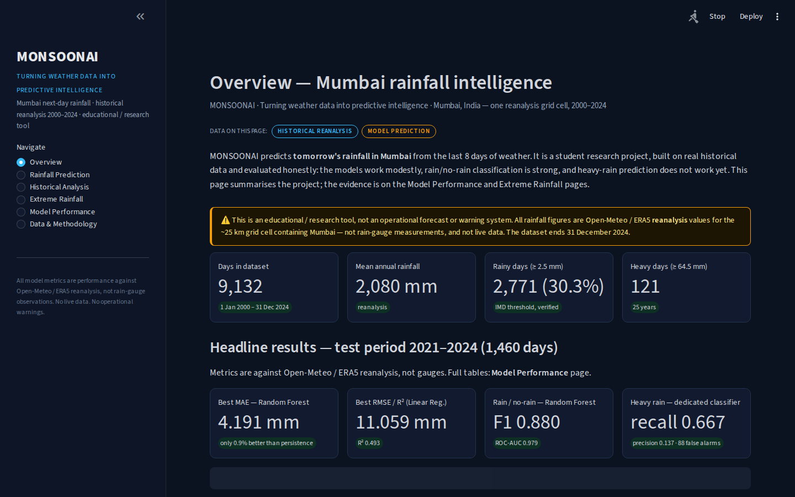
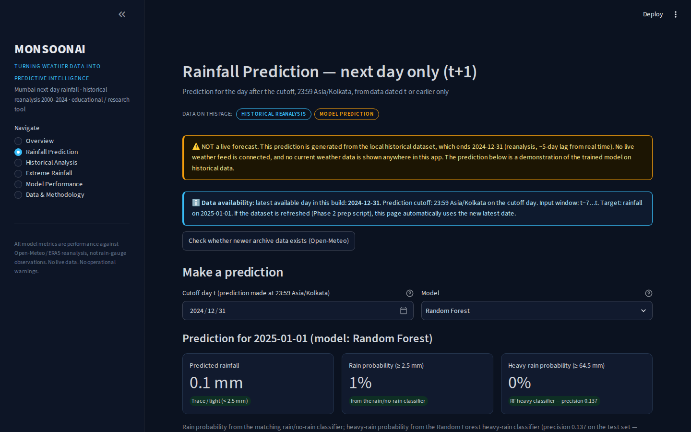
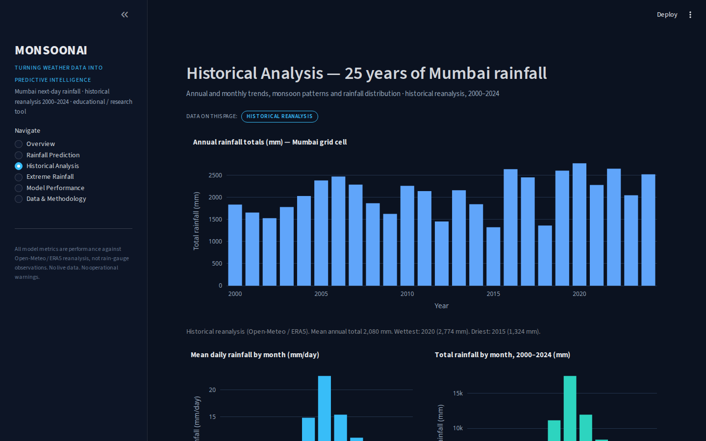
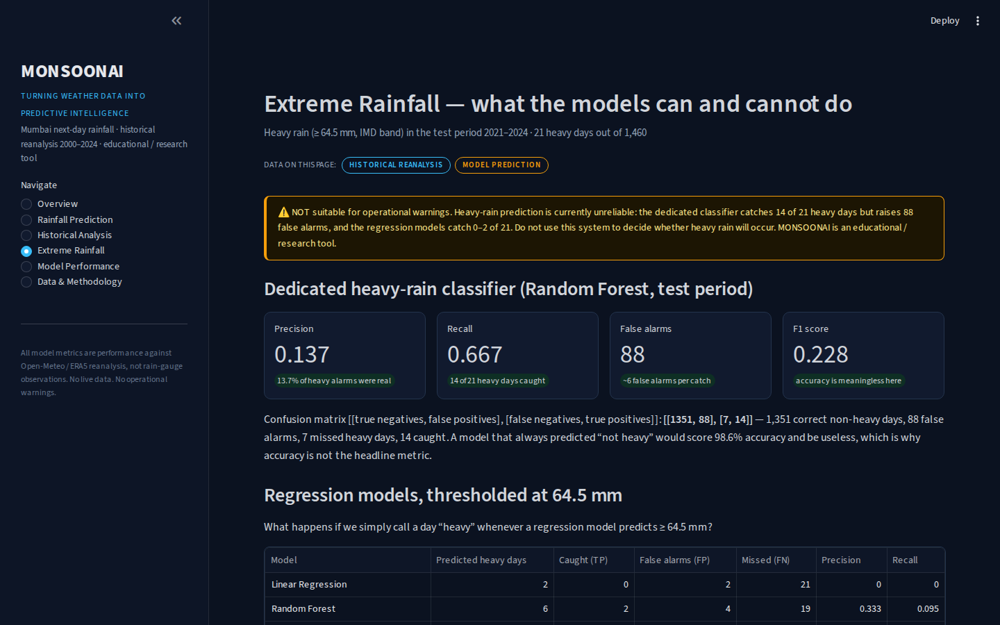
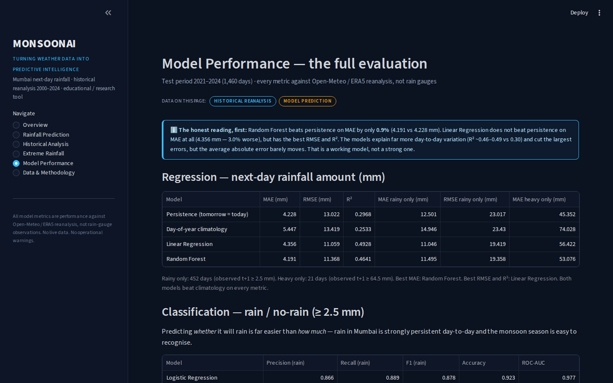
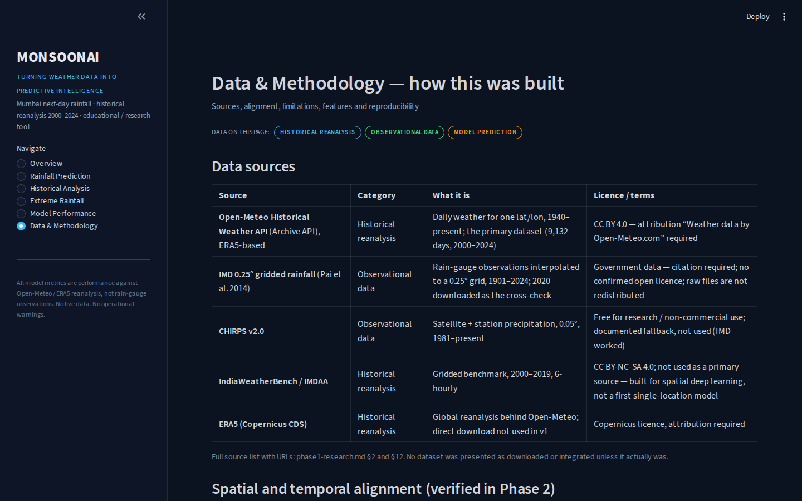

# MONSOONAI — AI-Powered Weather Forecasting & Extreme Rainfall Intelligence

**Turning Weather Data into Predictive Intelligence.**

MONSOONAI is a machine learning project that predicts next-day rainfall for Mumbai, India, from historical weather data — and evaluates itself honestly. It is an educational and research-oriented tool, built as a portfolio project. It is **not** an operational weather forecast and **not** a warning system.

**Status: the dashboard is built and tested locally. Deployment is pending — there is no live URL yet.**

## Project overview

Mumbai receives most of its annual rainfall in four monsoon months, and daily rainfall is a hard, noisy target. This project asks a narrow, defensible question: given the last eight days of weather, can a model predict *tomorrow's* rainfall in Mumbai better than simply repeating today's rainfall?

The answer, measured on four untouched test years (2021–2024), is: modestly, for the amount — and well, for whether it will rain at all. Heavy-rainfall prediction does not work at a useful level with this data, and this README says so instead of hiding it.

## Problem statement

- **Target:** next-day (t+1) rainfall in millimetres for one location — Mumbai (19.0760° N, 72.8777° E).
- **Two framings:** regression (how much rain tomorrow) and classification (will it rain tomorrow, at the IMD rainy-day threshold of 2.5 mm).
- **Secondary question:** can the models flag heavy rain (≥ 64.5 mm, the IMD "heavy" band)? The measured answer is no — see the evaluation below.

## Objectives

1. Build a scientifically defensible next-day rainfall prediction system from real, documented data.
2. Compare models against simple baselines on the same chronological test period, using identical evaluation.
3. Investigate extreme rainfall honestly, including false positives and false negatives.
4. Present the results in a working dashboard that labels every number by what it is: historical reanalysis, observational data, model prediction, or external forecast.
5. Keep the code understandable enough for a student to explain in an interview.

## System architecture

```
monsoonai-weather-intelligence/
├── app/                  Streamlit dashboard (6 pages)
│   ├── app.py            Entry point + navigation + theme
│   ├── data_loader.py    Loads data/artefacts; recomputes metrics
│   ├── feature_engine.py Reuses src/features.py (no duplicated definitions)
│   ├── predict.py        Next-day prediction from saved artefacts
│   ├── charts.py         Consistent Plotly styling
│   ├── ui_common.py      Data-category legend, warnings, footer
│   └── views/            One module per page
├── src/                  Data + modelling pipeline
│   ├── prepare_mumbai_daily.py   Raw Open-Meteo -> processed daily CSV
│   ├── extract_imd_mumbai.py     IMD .grd binary reader + comparison
│   ├── baseline_experiment.py    Persistence + climatology baselines
│   ├── features.py       27 features, leakage-checked
│   ├── train_models.py   Linear Regression + Random Forest (+ classifiers)
│   └── evaluate_models.py        Test evaluation, plots, metrics
├── data/
│   ├── raw/              NOT committed (see Data sources)
│   └── processed/        Clean daily dataset + IMD comparison table
├── artifacts/            Trained models, test predictions, metrics, settings
├── assets/screenshots/   Dashboard screenshots (actual app)
├── docs/                 Research, data quality, methodology, reports
├── notebooks/            Empty — EDA lives in the docs (see its README)
├── tests/                44 automated dashboard checks + screenshot script
├── config/               No config files yet (see its README)
├── requirements.txt      Pinned dependencies (Python 3.12)
├── runtime.txt           python-3.12 (Streamlit Cloud)
└── LICENSE               MIT
```

The dashboard loads its numbers from the saved artefacts at startup and recomputes the metrics from `artifacts/predictions_test.csv` — the figures on screen cannot drift from the evaluation report.

## Data sources

| Source | What it is | Licence / terms |
|---|---|---|
| **Open-Meteo Historical Weather API (Archive API)** — https://open-meteo.com/en/docs/historical-weather-api | Primary source. Daily + hourly historical weather for one latitude/longitude, served from ERA5 reanalysis. | Data under **CC BY 4.0** — attribution required: "Weather data by Open-Meteo.com" with a link to https://open-meteo.com/. Non-commercial use within the free tier (under 10,000 calls/day). |
| **IMD gridded rainfall (0.25°)** — https://www.imdpune.gov.in/cmpg/Griddata/Rainfall_25_Bin.html | Cross-check / ground-truth reference. Daily gridded rainfall from interpolated rain-gauge observations, 1901–2024. | No open licence text was found on the IMD pages. Citation required (Pai et al. 2014). Raw IMD files are **not** redistributed in this repository. |
| **ERA5 reanalysis (Copernicus CDS)** | The reanalysis behind Open-Meteo's archive. Used as background, not downloaded directly in this project. | Copernicus licence, free with attribution. |
| **CHIRPS v2.0** | Listed as a fallback cross-check in Phase 1; not needed — the IMD download worked. | Free for research/non-commercial use. |

Exact download commands are documented in `docs/data-sources.md`. The raw files are not committed: the IMD 2020 `.grd` binary (25,495,560 bytes) and the hourly Open-Meteo CSV (8.5 MB) can be reproduced with those commands.

**Four data categories — kept distinct everywhere in this project:**

- **Historical reanalysis** — Open-Meteo / ERA5 values (model-derived, gap-free by construction).
- **Observational data** — IMD gridded rainfall (interpolated gauge observations).
- **Model predictions** — numbers produced by this project's own models.
- **External forecasts** — not used anywhere in this project.

## Dataset description

- **Location:** Mumbai, one grid cell (~25 km) containing the city. Open-Meteo returned cell 19.086115° N, 72.85291° E. This is a grid-cell value, not a rain gauge in a neighbourhood.
- **Period:** 1 January 2000 – 31 December 2024, daily, Asia/Kolkata timezone.
- **Rows:** **9,132 days**, 14 columns, **0 missing values** in every column (measured; reanalysis is gap-free by construction).
- **Variables:** daily max/min/mean temperature, precipitation sum, rain sum, precipitation hours, relative humidity (daily mean from hourly values), mean sea-level and surface pressure (daily means from hourly values), max wind speed, dominant wind direction, max gusts, shortwave radiation.
- **Daily rainfall classification** (exhaustive, sums to 9,132 — see `docs/data-quality-note.md`):

| Category | Definition | Days | Share |
|---|---|---|---|
| Dry | exactly 0.00 mm | 5,468 | 59.9% |
| Light rain | 0 < rain < 2.5 mm | 893 | 9.8% |
| Rainy (IMD) | ≥ 2.5 mm | 2,771 | 30.3% |

- **Rainfall summary:** mean annual total 2,080 mm; wettest year 2020 (2,774 mm), driest 2015 (1,324 mm); wettest single day 251.1 mm (22 September 2016); monsoon (June–September) = 94.2% of all rain; heavy days (≥ 64.5 mm): 121; very heavy (≥ 115.6 mm): 21; extremely heavy (> 204.4 mm): 2.
- **Alignment check (2020):** Open-Meteo and IMD agree on *when* it rains (103 of 108 IMD rainy days were also rainy in Open-Meteo) but not *how much* — 2020 totals IMD 3,553 mm vs Open-Meteo 2,774 mm, i.e. reanalysis underestimates annual rainfall by about **22%**, spreads rain over more days (131 vs 108), and caps the daily maximum lower (169.8 vs 203.1 mm). Same-date correlation r = 0.704; 1-day-shifted r = 0.741, consistent with the two sources defining the "day" differently (IMD days end at 03:00 UTC / 08:30 IST; Open-Meteo days are Asia/Kolkata calendar days). Full detail in `docs/data-quality-note.md` and `docs/crosscheck-and-threshold.md`.

## Methodology

- **Prediction definition:** predict rainfall on day t+1, using only data dated t or earlier. Prediction cutoff 23:59 Asia/Kolkata. Input window t−7…t (eight days). Target: `precipitation_sum` on t+1, in millimetres. Full definition in `docs/prediction-definition.md`.
- **Chronological splits (identical for every model; the test set was never used for tuning):** train 2000–2017, validation 2018–2020, test 2021–2024 (1,460 days, 452 rainy, 21 heavy).
- **Features (27):** lagged rainfall (t, t−1, t−2, t−3, t−7), 3-day and 7-day rolling rainfall sum and mean, days since last rain (capped at 30), rainy days in the last 7 days, temperature (max/min/mean at t, 3-day mean), humidity (t, 3-day mean), pressure (t, 3-day change), wind (max at t, direction as sin/cos), seasonal features (day-of-year sin/cos, month, monsoon flag June–September), and day-of-year climatology computed from **training data only**.
- **Leakage audit:** every feature was audited against using only data dated t or earlier. No failures. See `docs/leakage-audit.md`.
- **Baselines (mandatory, reported alongside every model):** persistence (tomorrow's rainfall = today's rainfall) and day-of-year climatology (tomorrow = the training-period mean for that date).
- **Models:** Linear Regression (features standardised inside a pipeline) and Random Forest Regressor (best on validation: max_depth 10, n_estimators 200; validation MAE 3.911 mm). Rain/no-rain classifiers: Logistic Regression and Random Forest Classifier (best: max_depth 10, n_estimators 400, class_weight balanced; validation F1 0.9154). A dedicated heavy-rain Random Forest classifier was also trained for the extreme-rainfall analysis.
- **Not used, deliberately:** XGBoost (only if it measurably beat Random Forest on the same split — it was not needed for this comparison) and LSTM (not justified for a single 9,132-row daily series; lag features capture the same short-term signal with far less complexity).
- **Reproducibility:** fixed random seed 42. All settings are recorded in `artifacts/training_settings.json`; all metrics in `artifacts/evaluation_summary.json`.

## Model evaluation

All metrics below are on the untouched test period 2021–2024 (1,460 days), and all are performance **against Open-Meteo/ERA5 reanalysis, not against independent rain-gauge observations**. Real-world gauge accuracy is expected to be lower, especially for extremes. Full evaluation, residual analysis and plots: `docs/model-evaluation-report.md`.

### Regression — next-day rainfall (mm)

| Model | MAE | RMSE | R² | MAE, rainy days only | MAE, heavy days only |
|---|---|---|---|---|---|
| Persistence | 4.228 | 13.022 | 0.2968 | 12.501 | 45.352 |
| Day-of-year climatology | 5.447 | 13.419 | 0.2533 | 14.946 | 74.028 |
| Linear Regression | 4.356 | **11.059** | **0.4928** | **11.046** | 56.422 |
| Random Forest | **4.191** | 11.368 | 0.4641 | 11.495 | 53.076 |

Reading the numbers honestly: Random Forest has the best MAE, but beats persistence by only **0.9%** (4.191 vs 4.228 mm). Linear Regression has the best RMSE and R² but does not beat persistence on MAE. Both models explain far more day-to-day variation than the baselines (R² ~0.46–0.49 vs 0.30) and cut the largest errors, but the average absolute error barely moves. Today's rainfall carries 64% of the Random Forest's signal — the models are, in effect, smart persistence with small pressure and humidity adjustments.

### Classification — rain / no-rain (≥ 2.5 mm)

| Model | Precision (rain) | Recall (rain) | F1 (rain) | Accuracy | ROC-AUC |
|---|---|---|---|---|---|
| Logistic Regression | 0.866 | 0.889 | 0.878 | 0.923 | 0.977 |
| Random Forest Classifier | 0.845 | 0.918 | **0.880** | 0.923 | **0.979** |

Predicting *whether* it will rain is far easier than predicting *how much* — and the dashboard says exactly that.

### Heavy rain (≥ 64.5 mm) — the weak point, stated plainly

- 21 heavy days in the test period. Thresholded regression caught **0 of 21** (Linear Regression) and **2 of 21** (Random Forest). Persistence caught 6 of 21 — the trained models are worse than the naive baseline here.
- Dedicated heavy-rain classifier: precision **0.137**, recall **0.667**, F1 0.228, confusion matrix [[1351, 88], [7, 14]] — it catches 14 of 21 heavy days but raises **88 false alarms**, about 6 false alarms per heavy day caught. Accuracy 0.935 is meaningless here (always predicting "not heavy" would score 98.6%).
- **Verdict: heavy-rainfall prediction is not supportable at a useful level with this data and these models.** The Extreme Rainfall page of the dashboard shows the missed events, the false alarms, precision and recall prominently. Do not use this system to decide whether heavy rain will occur.

### Residuals

The worst test miss was 16 May 2021 (observed 199.9 mm, Random Forest predicted 32.2 mm). Eight of the ten worst misses are under-predictions of heavy rain; neither model ever predicts above ~114 mm against an observed maximum of 199.9 mm. Error concentrates in July (MAE ~14 mm); dry months are near-perfect because predicting near-zero is usually right.

## The dashboard

Six pages, all working, in a deep navy / atmospheric blue / restrained cyan design:

1. **Overview** — Mumbai rainfall intelligence and project summary.
2. **Rainfall Prediction** — next-day prediction only, with model selection, rain and heavy-rain probabilities, cutoff and data-availability information. Labelled "NOT a live forecast": the latest prediction (for 1 January 2025, from data through 31 December 2024) is a historical-data demonstration.
3. **Historical Analysis** — annual/monthly trends, monsoon patterns, rainfall distribution.
4. **Extreme Rainfall** — missed heavy-rain events, false alarms, precision and recall, with an explicit statement that this is not suitable for operational warnings.
5. **Model Performance** — baselines, regression and classification metrics, residuals, year-wise results, feature importance.
6. **Data & Methodology** — sources, alignment, spatial resolution, reanalysis limitations, feature definitions, reproducibility.

Screenshots of the actual app:








## Installation and execution

Requirements: Python 3.12.

```bash
git clone https://github.com/harshkalambe6-crypto/monsoonai-weather-intelligence.git
cd monsoonai-weather-intelligence
python3 -m venv .venv
source .venv/bin/activate
pip install -r requirements.txt
streamlit run app/app.py
# open http://localhost:8501
```

First load takes about 6 seconds (model artefacts loading); later page switches are fast. A full local setup and troubleshooting guide is in `docs/local-setup.md`.

## Reproducing the training

```bash
source .venv/bin/activate
python src/prepare_mumbai_daily.py     # raw Open-Meteo -> data/processed/mumbai_daily_2000-2024.csv
python src/baseline_experiment.py      # persistence + climatology baselines
python src/train_models.py             # Linear Regression + Random Forest (+ classifiers)
python src/evaluate_models.py          # test evaluation, plots, metrics
```

`src/extract_imd_mumbai.py` reproduces the IMD 2020 cross-check from the downloaded `.grd` file (see `docs/data-sources.md` for how to obtain it — it is not committed). Re-running training regenerates everything in `artifacts/`.

## Testing

`tests/test_app.py` runs 44 automated checks against the real app (Streamlit AppTest): every page loads without exception, the exact evaluation metrics appear on screen, the heavy-rain honesty numbers are present, the "NOT a live forecast" and "NOT suitable for operational warnings" statements are present, and the on-the-fly prediction for a known cutoff day matches the saved test prediction. Run it with:

```bash
python tests/test_app.py
```

Expected output: `ALL CHECKS PASSED`. `tests/screenshot.py` captures the dashboard screenshots with a headless browser (Playwright, local use only — not a runtime dependency).

## Limitations

- **Deployment is pending.** Nothing is hosted yet; the dashboard runs locally.
- **Data ends 31 December 2024.** The Open-Meteo archive now reaches 31 December 2025. Refreshing requires re-running the Phase 2 pipeline and re-training; the dashboard reports this and does not auto-refresh.
- **Reanalysis is not observation.** All model metrics are against Open-Meteo/ERA5 reanalysis. Reanalysis underestimates IMD gauge totals by about 22% (2020) and smooths localised extremes, so real-world gauge skill is expected to be lower, especially for heavy rain.
- **One grid cell, not a gauge.** "Mumbai rainfall" here means the ~25 km grid cell containing Mumbai. Neighbourhood-level extremes cannot be resolved.
- **Heavy-rain prediction does not work at a useful level** (see the evaluation above).
- **No live weather.** The app reads the local dataset only; there is no live observation or forecast feed.
- **Daily rainfall is noisy.** Even the best model averages ~4.2 mm absolute error, and ~11–12 mm on rainy days. The baselines are strong because Mumbai rain is highly persistent day-to-day.
- **One city only.** The pipeline is built for Mumbai; other Maharashtra cities would need the same per-location process.

## Future improvements

- Refresh the data through 2025 and re-train (Phase 2 pipeline + Phase 3, in that order).
- Extend to 5–8 Maharashtra cities as separate per-location models (Pune, Nashik, Kolhapur, Nagpur, Chhatrapati Sambhajinagar), with per-city evaluation — never a single pooled model, because rainfall regimes differ sharply across the state.
- Multi-year IMD retrieval for a longer observational cross-check (only 2020 was extracted so far).
- Investigate whether pressure-level ERA5 variables (e.g. 850 hPa humidity) add genuine skill — only if they beat the current models on the same test split.
- Revisit XGBoost on evidence, and LSTM only if the project expands to multi-location gridded data with a GPU budget — not for the single-city daily series.

## Author

**Harsh Ganesh Kalambe** — B.Sc. Data Science student (second year), KES Shroff College, Kandivali, Mumbai, India.

- LinkedIn: https://www.linkedin.com/in/harsh-kalambe-238765446/
- GitHub: https://github.com/harshkalambe6-crypto

Built as a portfolio project, with the aim of demonstrating Python programming, data analysis, statistical understanding, machine learning, time-series analysis, data visualisation and technical documentation — and of being able to explain every step of it in an interview.
